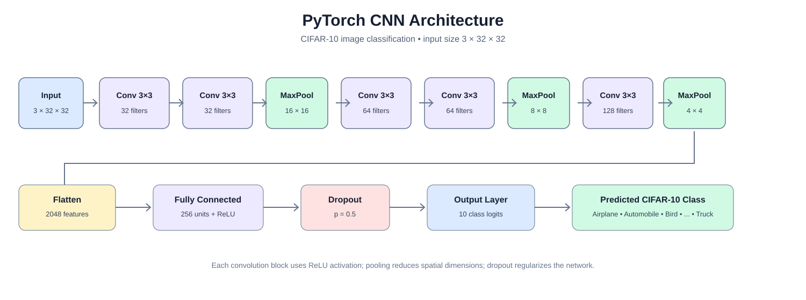

# Ex. No. 5 - Building and Training a CNN Using PyTorch

## Aim
To build, train and evaluate a Convolutional Neural Network (CNN) using PyTorch for image classification on the CIFAR-10 dataset.

## Software Requirements
- Python 3.9 or later
- PyTorch
- Torchvision
- NumPy
- Matplotlib
- Seaborn
- Scikit-learn

Install the dependencies:

```bash
pip install -r requirements.txt
```

## Dataset Description
The experiment uses the CIFAR-10 image dataset, which contains 60,000 colour images of size 32 × 32 pixels divided into ten classes.

| Dataset split | Number of images |
|---|---:|
| Training set | 50,000 |
| Test set | 10,000 |
| Total | 60,000 |
| Image dimensions | 32 × 32 × 3 |
| Number of classes | 10 |

Classes: Airplane, Automobile, Bird, Cat, Deer, Dog, Frog, Horse, Ship and Truck.

Torchvision downloads CIFAR-10 automatically into the local `data` directory the first time the program runs. No manual CSV or image-folder preparation is required.

## Algorithm

1. **Start** the program and import PyTorch, Torchvision, NumPy, Matplotlib and evaluation libraries.
2. Set random seeds and select the available computing device (CUDA GPU or CPU).
3. Load the CIFAR-10 training and test datasets using Torchvision.
4. Convert images into tensors and normalize the RGB channels.
5. Create DataLoaders to load images in batches of 128.
6. Define the CNN architecture:
   - Apply two 3 × 3 convolution layers with 32 filters and ReLU activation.
   - Apply max pooling and dropout.
   - Apply two 3 × 3 convolution layers with 64 filters and ReLU activation.
   - Apply max pooling and dropout.
   - Apply a convolution layer with 128 filters, ReLU and max pooling.
   - Flatten the feature maps and pass them through a 256-unit fully connected layer.
   - Apply dropout and produce ten output class scores.
7. Initialize the Cross-Entropy loss function and Adam optimizer.
8. Train the CNN for 10 epochs using forward propagation, loss calculation, backpropagation and weight updates.
9. Evaluate the model on the test dataset after every epoch.
10. Record training loss, training accuracy, test loss and test accuracy.
11. Calculate final test accuracy and generate a classification report.
12. Plot training and test accuracy and loss against epochs.
13. Generate a confusion matrix and sample prediction images.
14. Save the trained model weights and training history.
15. **Stop** the program.

## CNN Architecture



The network uses convolution layers to extract image features, max pooling to reduce spatial dimensions, dropout to reduce overfitting and a fully connected output layer to classify the image into one of ten categories.

## Program

The complete executable program is available separately in [`cnn_cifar10.py`](cnn_cifar10.py).

```python
import os
import random
import numpy as np
import matplotlib.pyplot as plt
import seaborn as sns
import torch
import torch.nn as nn
import torch.optim as optim

from torch.utils.data import DataLoader, Subset
from torchvision import datasets, transforms
from sklearn.metrics import confusion_matrix, classification_report

# ------------------------------------------------------------
# 1. Reproducibility and device
# ------------------------------------------------------------
SEED = 42
random.seed(SEED)
np.random.seed(SEED)
torch.manual_seed(SEED)

if torch.cuda.is_available():
    torch.cuda.manual_seed_all(SEED)

device = torch.device("cuda" if torch.cuda.is_available() else "cpu")
print("DEVICE:", device)

# CIFAR-10 class labels
class_names = [
    "Airplane", "Automobile", "Bird", "Cat", "Deer",
    "Dog", "Frog", "Horse", "Ship", "Truck"
]

# ------------------------------------------------------------
# 2. Load and preprocess CIFAR-10
# ------------------------------------------------------------
transform = transforms.Compose([
    transforms.ToTensor(),
    transforms.Normalize(
        mean=(0.4914, 0.4822, 0.4465),
        std=(0.2470, 0.2435, 0.2616)
    )
])

train_dataset = datasets.CIFAR10(
    root="./data", train=True, download=True, transform=transform
)
test_dataset = datasets.CIFAR10(
    root="./data", train=False, download=True, transform=transform
)

print("\nTRAINING IMAGES:", len(train_dataset))
print("TEST IMAGES:", len(test_dataset))
print("IMAGE SHAPE: 3 x 32 x 32")
print("NUMBER OF CLASSES:", len(class_names))

# Use the complete CIFAR-10 training and test sets.
train_loader = DataLoader(
    train_dataset, batch_size=128, shuffle=True, num_workers=0
)
test_loader = DataLoader(
    test_dataset, batch_size=128, shuffle=False, num_workers=0
)

# ------------------------------------------------------------
# 3. Define the Convolutional Neural Network
# ------------------------------------------------------------
class CNN(nn.Module):
    def __init__(self):
        super().__init__()

        self.features = nn.Sequential(
            # Block 1
            nn.Conv2d(3, 32, kernel_size=3, padding=1),
            nn.ReLU(inplace=True),
            nn.Conv2d(32, 32, kernel_size=3, padding=1),
            nn.ReLU(inplace=True),
            nn.MaxPool2d(2),
            nn.Dropout(0.25),

            # Block 2
            nn.Conv2d(32, 64, kernel_size=3, padding=1),
            nn.ReLU(inplace=True),
            nn.Conv2d(64, 64, kernel_size=3, padding=1),
            nn.ReLU(inplace=True),
            nn.MaxPool2d(2),
            nn.Dropout(0.25),

            # Block 3
            nn.Conv2d(64, 128, kernel_size=3, padding=1),
            nn.ReLU(inplace=True),
            nn.MaxPool2d(2),
            nn.Dropout(0.25)
        )

        self.classifier = nn.Sequential(
            nn.Flatten(),
            nn.Linear(128 * 4 * 4, 256),
            nn.ReLU(inplace=True),
            nn.Dropout(0.5),
            nn.Linear(256, 10)
        )

    def forward(self, x):
        x = self.features(x)
        return self.classifier(x)


model = CNN().to(device)
print("\nCNN ARCHITECTURE")
print(model)

criterion = nn.CrossEntropyLoss()
optimizer = optim.Adam(model.parameters(), lr=0.001)

# ------------------------------------------------------------
# 4. Train the CNN
# ------------------------------------------------------------
EPOCHS = 10
history = {
    "train_loss": [],
    "train_accuracy": [],
    "test_loss": [],
    "test_accuracy": []
}

for epoch in range(EPOCHS):
    model.train()
    running_loss = 0.0
    correct = 0
    total = 0

    for images, labels in train_loader:
        images, labels = images.to(device), labels.to(device)

        optimizer.zero_grad()
        outputs = model(images)
        loss = criterion(outputs, labels)
        loss.backward()
        optimizer.step()

        running_loss += loss.item() * images.size(0)
        _, predicted = torch.max(outputs, 1)
        total += labels.size(0)
        correct += (predicted == labels).sum().item()

    train_loss = running_loss / total
    train_accuracy = 100.0 * correct / total

    # Evaluate after each epoch.
    model.eval()
    test_loss_sum = 0.0
    test_correct = 0
    test_total = 0

    with torch.no_grad():
        for images, labels in test_loader:
            images, labels = images.to(device), labels.to(device)
            outputs = model(images)
            loss = criterion(outputs, labels)

            test_loss_sum += loss.item() * images.size(0)
            _, predicted = torch.max(outputs, 1)
            test_total += labels.size(0)
            test_correct += (predicted == labels).sum().item()

    test_loss = test_loss_sum / test_total
    test_accuracy = 100.0 * test_correct / test_total

    history["train_loss"].append(train_loss)
    history["train_accuracy"].append(train_accuracy)
    history["test_loss"].append(test_loss)
    history["test_accuracy"].append(test_accuracy)

    print(
        f"Epoch [{epoch + 1:02d}/{EPOCHS}] "
        f"Train Loss: {train_loss:.4f} "
        f"Train Accuracy: {train_accuracy:.2f}% "
        f"Test Loss: {test_loss:.4f} "
        f"Test Accuracy: {test_accuracy:.2f}%"
    )

# ------------------------------------------------------------
# 5. Final test evaluation
# ------------------------------------------------------------
model.eval()
all_labels = []
all_predictions = []

with torch.no_grad():
    for images, labels in test_loader:
        images = images.to(device)
        outputs = model(images)
        predictions = outputs.argmax(dim=1).cpu().numpy()

        all_predictions.extend(predictions)
        all_labels.extend(labels.numpy())

final_accuracy = 100.0 * np.mean(
    np.array(all_predictions) == np.array(all_labels)
)

print(f"\nFINAL TEST ACCURACY: {final_accuracy:.2f}%")
print("\nCLASSIFICATION REPORT")
print(classification_report(
    all_labels, all_predictions, target_names=class_names, digits=4
))

# ------------------------------------------------------------
# 6. Plot training and testing accuracy/loss graphs
# ------------------------------------------------------------
epochs = range(1, EPOCHS + 1)
fig, axes = plt.subplots(1, 2, figsize=(14, 5))

axes[0].plot(epochs, history["train_accuracy"], marker="o", label="Training Accuracy")
axes[0].plot(epochs, history["test_accuracy"], marker="o", label="Test Accuracy")
axes[0].set_title("CNN Accuracy")
axes[0].set_xlabel("Epoch")
axes[0].set_ylabel("Accuracy (%)")
axes[0].legend()
axes[0].grid(True, alpha=0.3)

axes[1].plot(epochs, history["train_loss"], marker="o", label="Training Loss")
axes[1].plot(epochs, history["test_loss"], marker="o", label="Test Loss")
axes[1].set_title("CNN Loss")
axes[1].set_xlabel("Epoch")
axes[1].set_ylabel("Loss")
axes[1].legend()
axes[1].grid(True, alpha=0.3)

fig.suptitle("PyTorch CNN Training on CIFAR-10", fontsize=15)
fig.tight_layout()
fig.savefig("training_graphs.png", dpi=180, bbox_inches="tight")
plt.close(fig)

# ------------------------------------------------------------
# 7. Confusion matrix
# ------------------------------------------------------------
cm = confusion_matrix(all_labels, all_predictions)
plt.figure(figsize=(10, 8))
sns.heatmap(
    cm, annot=True, fmt="d", cmap="Blues",
    xticklabels=class_names, yticklabels=class_names
)
plt.xlabel("Predicted Class")
plt.ylabel("Actual Class")
plt.title("CIFAR-10 CNN Confusion Matrix")
plt.tight_layout()
plt.savefig("confusion_matrix.png", dpi=180, bbox_inches="tight")
plt.close()

# ------------------------------------------------------------
# 8. Display sample predictions
# ------------------------------------------------------------
images, labels = next(iter(test_loader))
images_device = images.to(device)

with torch.no_grad():
    outputs = model(images_device)
    predicted_labels = outputs.argmax(dim=1).cpu()

mean = torch.tensor((0.4914, 0.4822, 0.4465)).view(3, 1, 1)
std = torch.tensor((0.2470, 0.2435, 0.2616)).view(3, 1, 1)

fig, axes = plt.subplots(2, 5, figsize=(14, 6))
for i, ax in enumerate(axes.flat):
    image = images[i] * std + mean
    image = image.permute(1, 2, 0).clamp(0, 1)

    true_name = class_names[labels[i].item()]
    predicted_name = class_names[predicted_labels[i].item()]
    ax.imshow(image)
    ax.set_title(f"True: {true_name}\nPred: {predicted_name}", fontsize=9)
    ax.axis("off")

fig.suptitle("CIFAR-10 Test Image Predictions")
fig.tight_layout()
fig.savefig("sample_predictions.png", dpi=180, bbox_inches="tight")
plt.close(fig)

# ------------------------------------------------------------
# 9. Save trained model and history
# ------------------------------------------------------------
torch.save(model.state_dict(), "cnn_cifar10.pth")
pd_history = __import__("pandas").DataFrame(history)
pd_history.index = np.arange(1, EPOCHS + 1)
pd_history.index.name = "epoch"
pd_history.to_csv("training_history.csv")

print("\nGENERATED FILES")
print("training_graphs.png")
print("confusion_matrix.png")
print("sample_predictions.png")
print("cnn_cifar10.pth")
print("training_history.csv")
print("\nRESULT: PyTorch CNN training and evaluation completed.")
```

## Output

The program prints the selected device, dataset dimensions, CNN architecture, epoch-wise training metrics, final test accuracy and classification report. No external CSV dataset or CSV output is required.

The dataset dimensions are:

```text
TRAINING IMAGES: 50000
TEST IMAGES: 10000
IMAGE SHAPE: 3 x 32 x 32
NUMBER OF CLASSES: 10
```

The epoch-wise accuracy and loss values and final test accuracy are calculated during execution. They depend on the installed PyTorch version and whether training runs on CPU or GPU; no fabricated accuracy values are reported here.

At the end of execution, the program prints:

```text
GENERATED FILES
training_graphs.png
confusion_matrix.png
sample_predictions.png
cnn_cifar10.pth

RESULT: PyTorch CNN training and evaluation completed.
```

## Graphs and Generated Images

After running the program, the following graphs are generated in the working directory:

| File | Contents |
|---|---|
| `training_graphs.png` | Training/test accuracy and loss against epochs |
| `confusion_matrix.png` | Classification performance across ten classes |
| `sample_predictions.png` | Ten test images with actual and predicted labels |

## Model Files
- `cnn_cifar10.pth` - trained CNN model weights.

## Execution

Run the program from the repository directory:

```bash
python cnn_cifar10.py
```

The first execution downloads CIFAR-10 automatically. Training takes longer on CPU; a CUDA-enabled GPU is recommended.

## Result
A Convolutional Neural Network was implemented using PyTorch and trained on the CIFAR-10 dataset. The program evaluates the trained network and generates accuracy/loss graphs, a confusion matrix and sample image predictions.
